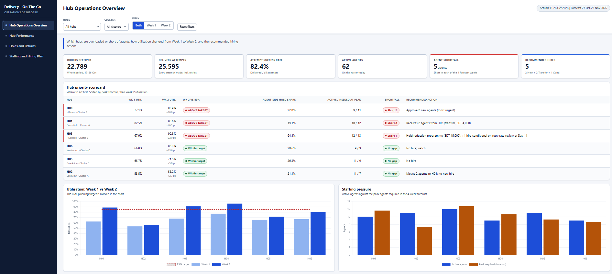

# Delivery OTG Dashboard

**Interactive Operational Analytics & Live Tracking Dashboard Backend**

## Project Overview
Delivery OTG Dashboard is a backend-driven operational analytics system built using Google Sheets and Google Apps Script. It aggregates delivery data, monitors hub performance, tracks holds or returns, and optimizes workforce staffing through a multi-page web application.

## Objectives
- Track daily dispatch, assigned orders, and successful delivery statuses.
- Monitor metrics including latency, polling attempts, and cache chunking performance.
- Evaluate hub and agent performance analytics.
- Streamline warehouse operations regarding hold reasons and order logs.

## Technology Stack
- Google Sheets & BigQuery 
- Google Apps Script (Backend & Templating Engine)
- HTML5 / CSS3 / JavaScript (ES6)

## Dashboard Preview

## Project Structure
- `apps-script/` — Apps Script core configuration, templating architecture (`Index.html`, `App.html`), and business logic scripts (`Code.gs`).
- `docs/screenshots/` — Analytical layout interface snapshots.

## Live Demo
[Open Live Dashboard](https://github.io)

## Deployment Setup
1. Mount the core ecosystem within the Google Sheets dataset extensions.
2. Link the repository source files to the Google Apps Script environment.
3. Configure the underlying BigQuery schemas or configurations if applicable.
4. Deploy the module as a Web App (`Execute as: Me`, `Who has access: Anyone`).
5. Update the live macro URL inside the root static configurations.
